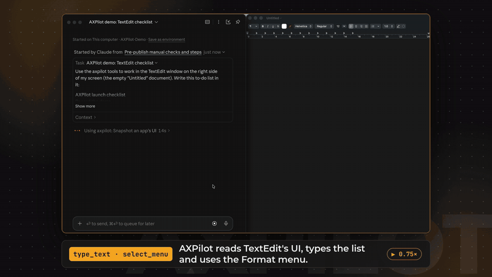
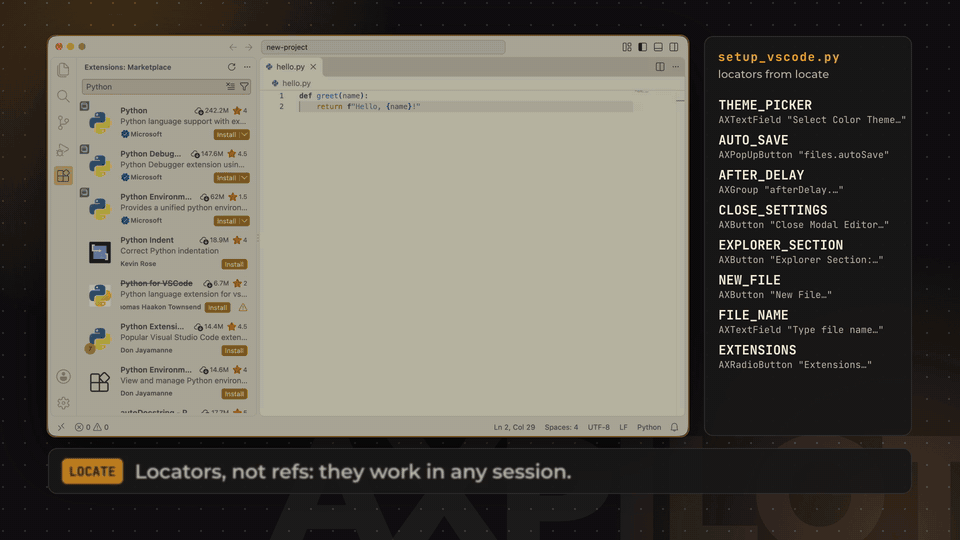

# AXPilot

**The MCP server for macOS.** AXPilot lets any AI agent see and operate the apps on your Mac,
through the macOS Accessibility API first and screenshots second, with safety controls that are
on by default.

[](https://github.com/vansh3503/Mac-Mcp/actions/workflows/ci.yml)
[](#roadmap)
[](https://pypi.org/project/axpilot/)
[](https://github.com/vansh3503/Mac-Mcp/blob/main/pyproject.toml)
[](https://github.com/vansh3503/Mac-Mcp/blob/main/docs/install.md)
[](https://github.com/vansh3503/Mac-Mcp/blob/main/LICENSE)

<!-- mcp-name: io.github.vansh3503/axpilot -->

<p align="center">
  
</p>
<p align="center"><sub>A real recording on macOS 26: Claude Code (left) drives TextEdit (right) through AXPilot. Sped up in places; the speed is shown on screen.</sub></p>

> **Project status: alpha.** The first alpha, 0.1.0a1, is [on PyPI](https://pypi.org/project/axpilot/):
> `uv tool install axpilot`, then [three commands](#install) to connect it. It is verified on
> macOS 26 on Apple silicon; macOS 14 and 15 and Intel Macs are not tested yet. Expect breaking
> changes until 1.0. See the [roadmap](https://github.com/vansh3503/Mac-Mcp/blob/main/docs/PLAN.md#15-roadmap-and-milestones-one-maintainer--ai-assistance).

## Why AXPilot

- **Sees the UI the way macOS does.** A compact text snapshot of the accessibility tree gives every
  button, field, list and menu a short ref (`e1`, `e2`, …), so agents act on elements instead of
  guessing pixels. Text-only and local models work; vision is optional.
- **Acts reliably.** Each action tries the most robust strategy first (an Accessibility action),
  falls back to synthetic mouse and keyboard events, and returns a diff of what changed.
- **Scripts that outlive the session.** Ask for a script and `locate` turns the elements an agent
  used into stable [locators](https://github.com/vansh3503/Mac-Mcp/blob/main/docs/locators.md)
  (the AXIdentifier first, then role and name), each checked to match exactly one element, plus a
  ready-to-run Python script.
- **Safe by default.** Scripting is off, destructive actions need your confirmation, password
  managers and the Privacy & Security settings are off limits, secure fields are never read, and
  there is **no telemetry**.
- **Works with any MCP client or agent framework.** Standard MCP over stdio or Streamable HTTP:
  Claude Desktop, Claude Code, Cursor, VS Code, Codex CLI, Gemini CLI, OpenAI Agents SDK,
  LangGraph, Pydantic AI and more.
- **Permissions that just work.** A tiny frozen `AXPilot.app` launcher holds the macOS
  permissions, so you grant Accessibility once, to AXPilot, and every client can use it, across updates.

## Electron apps too: VS Code

<p align="center">
  
</p>
<p align="center"><sub>A real recording on macOS 26 with AXPilot 0.1.0a1. Claude Code first drove a throwaway VS Code through AXPilot (light theme, Auto Save, a new file, an extension search); here a script built from AXPilot's locators replays that setup on a fresh VS Code, in real time.</sub></p>

## Features

The feature set planned for 1.0. Every tool below is implemented and tested against the simulated
desktop. On a real Mac (macOS 26), the perception and input tools are verified, including
dropdowns, menus and dialogs; the app, system, scripting and browser tools, the kill switch and the
on-screen indicator are not yet. The [tool reference](https://github.com/vansh3503/Mac-Mcp/blob/main/docs/tools.md) documents each one.

| Area | What you get |
|---|---|
| **Perception** | Accessibility snapshots with refs, element search, element inspection, stable locators for automation scripts, diffs after every action, screenshots with a `screenshot_id` for coordinate mapping, Vision OCR, app/window/display lists |
| **Actions** | Click, type (layout-independent), keyboard shortcuts (layout-aware), scroll, drag, set values, raw AX actions, **menu-bar commands by path**, forms, apps, windows, opening files and URLs |
| **Safety** | Profiles and toolsets, app and window deny-lists, Terminal rule, secure-field protection, confirmations, rate limit, audit log, yield-to-user, kill switch, client pairing |
| **Integrations** | Any MCP client; tested framework examples; an [Agent Skill](https://github.com/vansh3503/Mac-Mcp/blob/main/skills/axpilot/SKILL.md); a `computer` profile for vision-first loops; a Windows-MCP naming profile |

## How it works

```
 MCP clients and agent frameworks
 (Claude, Cursor, VS Code, Codex, OpenAI Agents SDK, LangGraph, …)
        │ spawn `axpilot stdio`                │ Streamable HTTP (`axpilot http`)
        ▼                                      │ 127.0.0.1 + bearer token
 ┌────────────────┐   Unix socket (0600)       │
 │ axpilot bridge │──────────────┐             │
 │ (no perms)     │              ▼             ▼
 └────────────────┘   ┌──────────────────────────────────────────┐
                      │ AXPilot.app: tiny frozen launcher        │
                      │   └─ Python host (child process)         │
                      │       ├ MCP server: tools and schemas    │
                      │       ├ Policy and safety layer          │
                      │       └ Engine: Accessibility, input,    │
                      │         ScreenCaptureKit, Vision OCR     │
                      └──────────────────────────────────────────┘
        macOS permissions (Accessibility, Screen Recording) → AXPilot.app
```

[Spike S1](https://github.com/vansh3503/Mac-Mcp/blob/main/docs/spikes/S1-launcher-tcc.md) confirmed
this design on macOS 26 (Apple silicon): the permission prompts name AXPilot, and one grant covers
every client. **Direct mode** (`axpilot stdio --direct`) runs everything in one process instead;
macOS then attributes permissions to whichever app started the server (your terminal, Claude, Cursor, …).

## Install

**Requirements:** macOS 14 Sonoma or later, Apple silicon or Intel.

### From PyPI (alpha)

You need [uv](https://docs.astral.sh/uv/) (or pipx).

```sh
uv tool install axpilot          # or: pipx install axpilot
axpilot setup                    # installs ~/Applications/AXPilot.app and its runtime
axpilot connect claude-desktop   # or claude-code, cursor, vscode, … (see --list)
axpilot doctor                   # checks the installation
```

Restart your MCP client, then ask it to use AXPilot ("take a snapshot of Finder"):

1. The first time a client connects, AXPilot asks you whether to allow it. Allow it.
2. The first tool call makes macOS ask whether AXPilot may control your computer. Open System
   Settings, switch on **AXPilot** under Accessibility, and ask again; no restart is needed.
3. Screenshots and OCR also need **Screen Recording** for AXPilot. macOS applies that grant only
   after AXPilot restarts: run `killall AXPilot`, then restart your MCP client.

Details and other channels: [docs/install.md](https://github.com/vansh3503/Mac-Mcp/blob/main/docs/install.md).
Permissions explained: [docs/permissions.md](https://github.com/vansh3503/Mac-Mcp/blob/main/docs/permissions.md).

### From source (contributors)

You need uv and the Xcode Command Line Tools (`xcode-select --install`), which build the launcher.

```sh
git clone https://github.com/vansh3503/Mac-Mcp.git axpilot
cd axpilot
uv sync
launcher/build.sh                      # builds launcher/build/AXPilot.app
uv run axpilot setup --dev-source .    # installs ~/Applications/AXPilot.app and its runtime
uv run axpilot connect claude-desktop  # or claude-code, cursor, vscode, … (see --list)
uv run axpilot doctor                  # checks the installation
```

A launcher you build yourself has a different code signature from the published one, so macOS
asks for the permissions again when you switch between the two.

Other ways to run it, without the launcher:

```sh
uv run axpilot stdio --engine fake   # the simulated desktop (any OS, no permissions needed)
uv run axpilot stdio --direct        # direct mode: grant Accessibility to the app that starts it
```

`axpilot stdio` speaks MCP on stdin/stdout, so it waits for a client. To poke at it by hand, use
the [MCP Inspector](https://github.com/modelcontextprotocol/inspector):
`npx @modelcontextprotocol/inspector uv run axpilot stdio --engine fake`.

## Connect a client

### Installed from PyPI

`axpilot connect <client>` writes the config for you (with a backup). The snippets it writes:

**Claude Desktop, Cursor** (`~/.cursor/mcp.json`) and most other clients:

```json
{ "mcpServers": { "axpilot": { "command": "axpilot", "args": ["stdio"] } } }
```

(Claude Desktop needs the absolute path of `axpilot`, e.g. `/Users/you/.local/bin/axpilot`.)

**Claude Code**:

```sh
claude mcp add axpilot -- axpilot stdio
```

**VS Code** (`.vscode/mcp.json` in a workspace, or your user `mcp.json`):

```json
{ "servers": { "axpilot": { "type": "stdio", "command": "axpilot", "args": ["stdio"] } } }
```

More clients (Windsurf, Zed, Codex CLI, Gemini CLI, LM Studio, Goose, Cline, Continue):
[docs/clients.md](https://github.com/vansh3503/Mac-Mcp/blob/main/docs/clients.md).

### From a source checkout

In the clone, `uv run axpilot connect <client>` writes the client's config for you (with a
backup), pointing it at the checkout's `axpilot` by absolute path. Restart the client afterwards.
For direct mode, or to write the config by hand, see
[docs/clients.md](https://github.com/vansh3503/Mac-Mcp/blob/main/docs/clients.md#from-source-today).

## Use it from an agent framework

Anything that speaks MCP works. Two examples (APIs as of writing; one for each of eleven
frameworks is in [`examples/frameworks/`](https://github.com/vansh3503/Mac-Mcp/tree/main/examples/frameworks)):

**OpenAI Agents SDK**

```python
from agents import Agent, Runner
from agents.mcp import MCPServerStdio

async with MCPServerStdio(params={"command": "axpilot", "args": ["stdio"]}, cache_tools_list=True) as mac:
    agent = Agent(
        name="Mac operator",
        instructions="Call snapshot before acting, act on element refs, and verify the result.",
        mcp_servers=[mac],
    )
    result = await Runner.run(agent, "Open Notes and create a note titled 'Groceries'")
```

**LangChain / LangGraph**

```python
from langchain.agents import create_agent
from langchain_mcp_adapters.client import MultiServerMCPClient

client = MultiServerMCPClient({"axpilot": {"command": "axpilot", "args": ["stdio"], "transport": "stdio"}})
agent = create_agent("<your-model>", await client.get_tools())
```

More frameworks: [docs/frameworks.md](https://github.com/vansh3503/Mac-Mcp/blob/main/docs/frameworks.md).

## Tools

The 1.0 tool surface, implemented. Profiles pick a starting set: `minimal` (10 tools, for small or
local models), `standard` (default), `full`, and `computer` (one vision-first `computer` tool). A
`windows-mcp` naming exposes the same tools under Windows-MCP's names and parameters.

| Toolset | Tools | Default |
|---|---|---|
| `observe` | `snapshot`, `screenshot`, `find`, `explore`, `read`, `inspect`, `locate`, `ocr`, `list_apps`, `list_windows`, `list_displays`, `wait_for`, `status` | on (read-only) |
| `input` | `click`, `type_text`, `press_keys`, `scroll`, `drag`, `move_mouse`, `set_value`, `select_option`, `perform_action`, `select_menu`, `fill_form`, `handle_dialog` | on |
| `apps` | `app`, `window`, `open` | on |
| `system` | `clipboard`, `notify`, `spotlight_search`, `system_info`, `system_control`, `processes` | `clipboard` on |
| `scripting` | `shell`, `applescript`, `shortcuts`, `defaults` | **off** |
| `browser` | `browser_tabs`, `browser_read`, `browser_eval_js` | **off** |
| `computer` | `computer` | `computer` profile only |

Every tool has an input and output schema, MCP annotations (`readOnlyHint`, `destructiveHint`, …)
and stable error codes such as `STALE_REF`, `BLOCKED_BY_POLICY` or `USER_ACTIVE`. Full reference,
generated from the code: [docs/tools.md](https://github.com/vansh3503/Mac-Mcp/blob/main/docs/tools.md).

## Safety defaults

| Control | Default |
|---|---|
| Profile | `standard`; `scripting` and `browser` toolsets off |
| Confirmations | Required for destructive actions (shell, AppleScript, JS eval, running a shortcut, force quit, `defaults` write, process kill), showing the exact command |
| App deny-list | Keychain Access, Passwords, 1Password, Bitwarden, LastPass, Dashlane, KeePassXC |
| Window deny-list | The Privacy & Security pane of System Settings |
| Terminal rule | Typing into Terminal, iTerm2, Ghostty, Warp and similar apps is blocked unless the `shell` tool is enabled |
| Secure fields | Values never returned; typing refused unless `allow_secure_fields = true` |
| Rate limit | 120 input actions per minute |
| Yield to user | On: input pauses while you are using the mouse or keyboard |
| Audit log | `~/Library/Logs/AXPilot/audit.jsonl`, arguments redacted |
| Client pairing | The host asks once per client app before it may connect |
| Kill switch, indicator | ⌃⌥⌘. stops the agent (press again to resume); a frame and pill show while it acts *(implemented, not yet run on a Mac)* |
| Telemetry | **None** |

Screen content is untrusted input for an agent. Read the
[security model](https://github.com/vansh3503/Mac-Mcp/blob/main/docs/security.md) before enabling
`scripting` or `browser`. To report a vulnerability, see [SECURITY.md](https://github.com/vansh3503/Mac-Mcp/blob/main/SECURITY.md).

## How AXPilot compares

AXPilot is the macOS counterpart of [Windows-MCP](https://github.com/CursorTouch/Windows-MCP), with
a tool surface (and an optional naming profile) that lets Windows-MCP prompts carry over.
Other good projects in this space include [MacOS-MCP](https://github.com/CursorTouch/MacOS-MCP)
(Python + PyObjC, the closest peer), [Peekaboo](https://github.com/steipete/Peekaboo) (Swift),
[mcp-server-macos-use](https://github.com/mediar-ai/mcp-server-macos-use) (Swift) and
[cua-driver](https://github.com/trycua/cua). AXPilot's focus:

1. **Permissions that survive updates**: a frozen launcher holds the grant for every client.
2. **Safety and privacy as the headline**: no telemetry, pairing, kill switch, confirmations, audit.
3. **Spec-first MCP**: schemas, annotations, structured output, deterministic tool order, stateless handles.
4. **Integration kit and evals**: framework examples tested in CI, an Agent Skill, published eval results.

## Roadmap

About 12 weeks to 1.0: `v0.1` alpha (engine and core tools in direct mode; 0.1.0a1 is out),
`v0.2` beta (launcher, host app, safety), `v0.3` public preview (one-line installer, `connect` for
12 clients, MCP Registry), `v0.9` (full toolsets, OCR, frameworks, evals), then `v1.0`. Details and the open questions are in the
[project plan](https://github.com/vansh3503/Mac-Mcp/blob/main/docs/PLAN.md); decisions are recorded as
[ADRs](https://github.com/vansh3503/Mac-Mcp/tree/main/docs/adr).

## Contributing

Contributions are welcome, and most of the code (server, policy, perception) runs and is tested on
Linux. Start with [CONTRIBUTING.md](https://github.com/vansh3503/Mac-Mcp/blob/main/CONTRIBUTING.md);
AI coding agents should read [AGENTS.md](https://github.com/vansh3503/Mac-Mcp/blob/main/AGENTS.md).
Please follow the [Code of Conduct](https://github.com/vansh3503/Mac-Mcp/blob/main/CODE_OF_CONDUCT.md).

## License

[Apache-2.0](https://github.com/vansh3503/Mac-Mcp/blob/main/LICENSE).

## Acknowledgements

AXPilot is inspired by [Windows-MCP](https://github.com/CursorTouch/Windows-MCP) by CursorTouch,
whose tool design and install experience set the bar for desktop MCP servers. Thanks also to the
authors of [PyObjC](https://github.com/ronaldoussoren/pyobjc), the
[MCP Python SDK](https://github.com/modelcontextprotocol/python-sdk) and the projects listed above.

Thanks to **Zeel Thakkar**, who helped ship the 0.1.0a1 release to PyPI and is working on automating
Electron apps with AXPilot, starting with the VS Code demo above.

"Mac" and "macOS" are trademarks of Apple Inc. Claude and Claude Code are trademarks of Anthropic.
Other product and framework names mentioned here (such as Cursor, VS Code, LangChain and CrewAI) are
trademarks of their respective owners and are used only to describe compatibility. AXPilot is an
independent project and is not affiliated with or endorsed by any of them.

The demo video's voiceover was made with ElevenLabs and its music comes from the HeyGen audio library.
